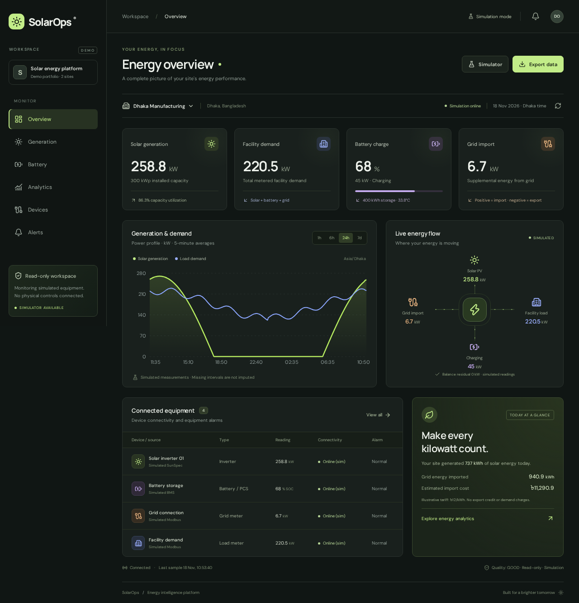

# Smart Solar Power Monitoring & Energy Optimization System

**SolarOps** is a read-only Solar EMS MVP built with Next.js, React, TypeScript, and ASP.NET Core .NET 10. Explore two simulated Bangladesh sites, inspect energy flow and history, test equipment faults, and export accepted measurements.

All measurements are **synthetic**. Equipment control is disabled at the API. Demo authentication is for evaluating the simulator; real users and hardware require a later commissioning phase.

## Vercel cloud demo

The [deployed cloud demo](https://smart-solar-monitor-ashy.vercel.app) runs the dashboard and serverless API on Vercel. The production address is public; preview deployment addresses retain Vercel authentication.

Cloud mode reconstructs synthetic measurements on request and polls every five seconds. It stores each visitor's scenario timeline, acknowledgments, and audit events in a private Vercel Blob record. Historical charts and CSV exports are explicitly labeled reconstructed simulation; they are not an MQTT ingestion archive. Sessions last eight hours, are isolated between visitors, and their storage records expire automatically after one day. The ASP.NET/SQLite/SQL Server/MQTT runtime below remains available for local and container use.

See [Vercel deployment instructions](docs/vercel-deployment.md) for settings, environment variables, and verification.



## Run with Docker

```sh
docker compose up --build
```

Open [http://localhost:3000](http://localhost:3000) and select **Open demo workspace**. The database and session keys persist in named volumes. Only the web port is published. Allow time for the initial image downloads and build.

To exercise MQTT 5 transport, persistent broker sessions, and the database outbox:

```sh
docker compose -f compose.yaml -f compose.mqtt.yaml up --build
```

To use SQL Server instead of SQLite, set `SQLSERVER_PASSWORD` to a strong development password, then run:

```sh
docker compose -f compose.yaml -f compose.sqlserver.yaml up --build
```

Both overlays can be combined. SQL Server needs an x86-64 host and sufficient memory. These configurations enable demo sign-in to a synthetic workspace and are intended for development and evaluation.

## Run locally

Install **Node.js 24+** and the **.NET 10 SDK**.

```sh
npm ci
```

In one terminal:

```sh
npm run dev:api
```

In a second terminal:

```sh
npm run dev
```

Open [http://localhost:3000](http://localhost:3000). The API runs on port 5080. Its launch profile enables the development demo session. `API_URL` changes the Next.js proxy destination; set it in the web process before building or starting development. See [.env.example](.env.example).

The first API startup creates a local SQLite database and seeds the preceding 24 hours at five-minute intervals. A worker generates new samples every five seconds. No external data provider or API key is required.

## What works

- Overview, generation, battery, analytics, device registry, and alert views.
- Independent site selection, equipment search, and site-scoped server authorization.
- Solar, load, battery, and grid readings with source timestamps, quality, age, and a 15-second freshness threshold.
- SignalR updates with reconnection and a 10-second polling fallback.
- Bounded history ranges, five-minute/hourly aggregation, and explicit nulls for missing buckets.
- Local-day energy integration and illustrative import costs in BDT.
- Sunny, cloudy, night, disconnected gateway, and hot-battery scenarios.
- Active/resolved alert history, idempotent acknowledgment, and persisted audit records.
- CSV export of accepted measurements from the preceding 24 hours.
- Optional MQTT 5/QoS 1 transport with a persisted outbox, replay, deduplication, and quarantine.
- SQLite by default; SQL Server through the same Entity Framework model.
- Responsive layout, keyboard navigation, modal focus handling, and reduced-motion support.

Open **Simulator**, choose **Battery high temperature**, and visit **Alerts** to acknowledge the warning. Choose **Gateway disconnected** and wait up to 20 seconds to see stale readings and paused flow animation. Return to **Sunny** to restore measurements and resolve the faults. Scenario and alert state are shared by demo sessions.

## Measurement conventions

Power is in kW; energy is in kWh. Positive battery power means discharge, negative means charge. Positive grid power means import, negative means export.

```text
solar + battery + grid = facility load
```

The simulator includes losses inside the demand boundary. SOC is an illustrative waveform, not a battery physics model or a validated BMS estimate. Imported energy cost uses an example tariff of **BDT 12/kWh**, with no export credit, demand charges, or claimed savings.

Timestamps are stored and served in UTC. The interface displays `Asia/Dhaka`. Daily energy starts at local midnight and uses trapezoidal integration; gaps longer than six minutes and bad-quality intervals are excluded. Sampled energy estimates are not revenue-meter measurements.

## Verify

```sh
dotnet test tests/platform-api
npm run test:cloud
npm run typecheck
npm run build
npx playwright install chromium
npm run test:e2e
```

Playwright starts the API and production web server when they are not already running. Tests cover sign-in, site switching, equipment search, temperature faults, acknowledgment, offline freshness, recovery, CSV export, session persistence, sign-out, and mobile navigation. CI runs backend tests, the production build, and browser tests.

## Repository

| Path                    | Responsibility                                                              |
| ----------------------- | --------------------------------------------------------------------------- |
| `apps/web-dashboard`    | Next.js dashboard and same-origin API/SignalR proxy                         |
| `services/platform-api` | Authenticated API, registry, storage, ingestion, simulator, alerts, SignalR |
| `tests/platform-api`    | Calculation, ingestion, contract, and API integration tests                 |
| `tests/e2e`             | Desktop/mobile browser journeys                                             |
| `infrastructure`        | Container builds and development MQTT configuration                         |
| `docs/architecture.md`  | HLD, LLD, persistence, API, and operating boundaries                        |
| `docs/roadmap.md`       | Follow-on work from the supplied enterprise design                          |

The initial schema uses EF `EnsureCreated` for fresh evaluation databases. Versioned migrations, OIDC/MFA, real equipment adapters, TimescaleDB, Redis, forecasts, and optimization remain roadmap items. The registry is a fixed definition in `Models.cs`. See [architecture details](docs/architecture.md).
